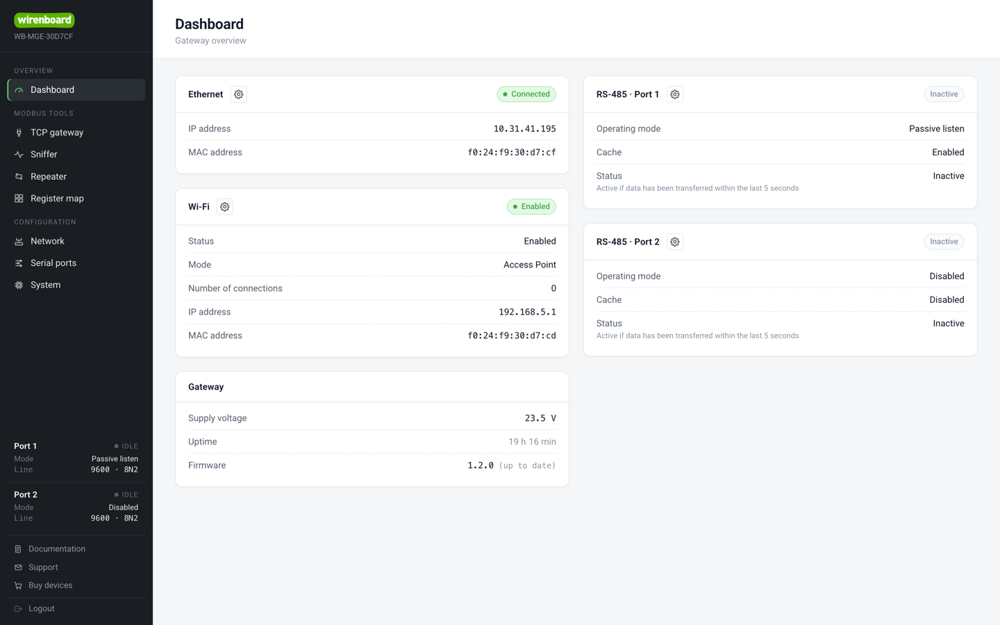
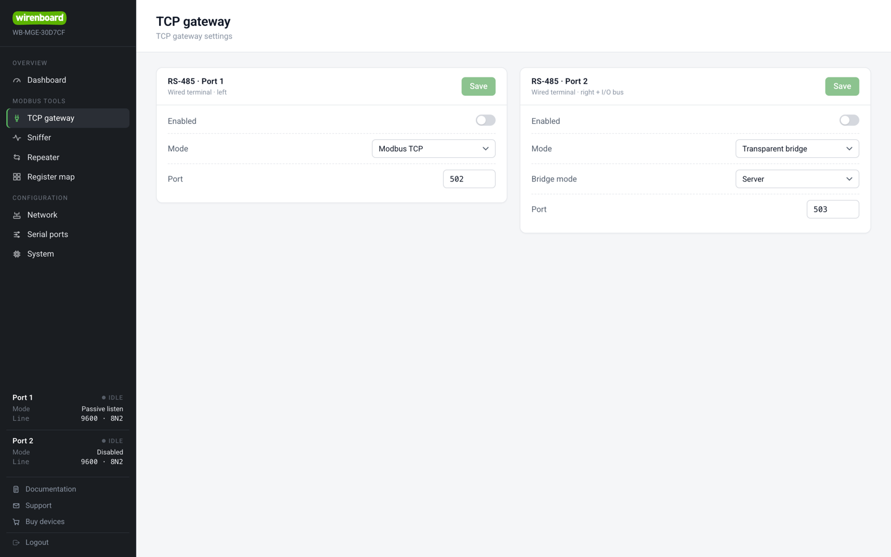
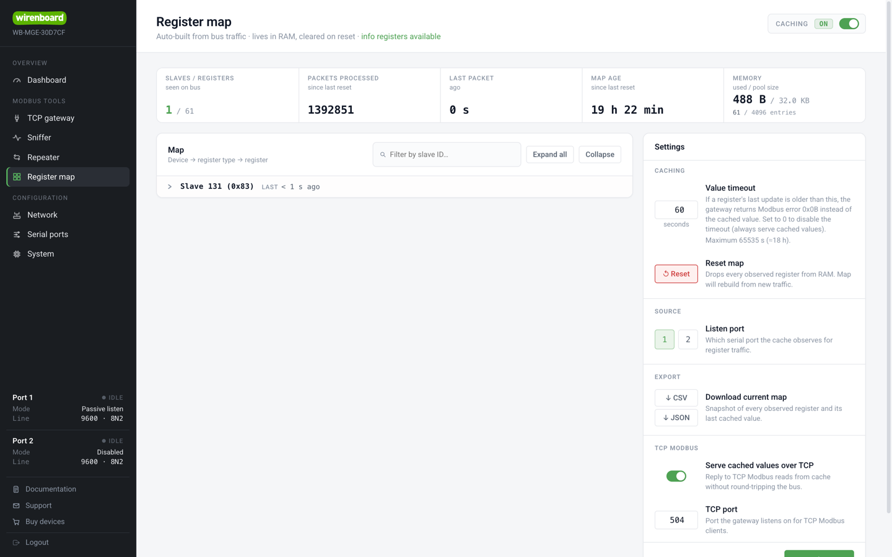
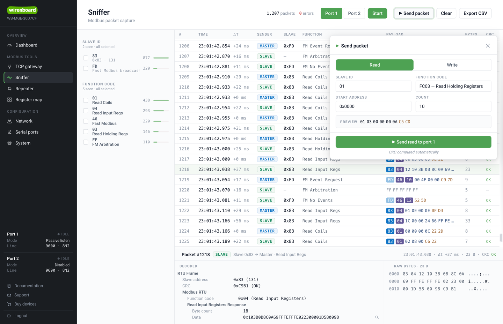
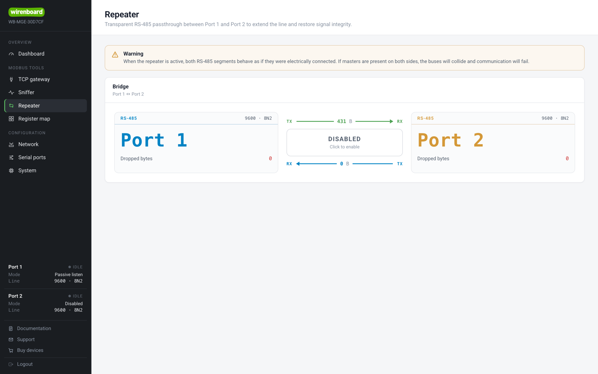
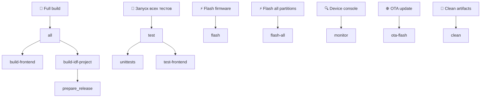
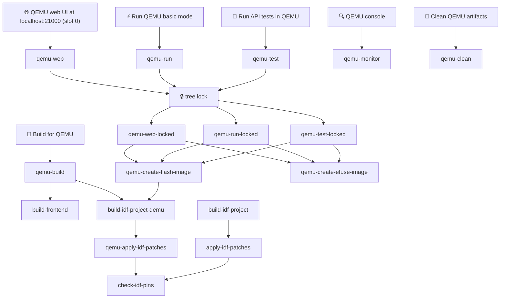

# WB-MGE
Мультипротокольный шлюз Wiren Board

[English README](README.md)

## Описание проекта

WB-MGE предназначен для подключения устройств с интерфейсом RS-485 и боковых модулей
ввода-вывода WBIO к серверу автоматизации через Ethernet или Wi-Fi.

Все функции, описанные ниже, настраиваются и контролируются через встроенный веб-интерфейс:



Для каждого из портов доступно два режима:

 - **Modbus TCP** — только для Modbus-устройств: полноценный конвертер **Modbus TCP ↔ Modbus RTU**.
   Для сети шлюз выступает Modbus TCP-сервером, а на шине RS-485 — Modbus RTU-мастером: снимает
   MBAP-заголовок из TCP-запроса, формирует RTU-кадр (добавляет CRC), опрашивает устройство и
   упаковывает RTU-ответ обратно в Modbus TCP.
 - **Прозрачный шлюз** — подходит для любых протоколов, работающих поверх RS-485; байты
   пересылаются «как есть», без разбора кадров. Может работать как TCP-**сервер** (ожидает
   входящие подключения) или TCP-**клиент** (сам подключается к удалённому TCP-узлу `ip:port`).

   

   *Каждый порт независимо переключается между режимами **Modbus TCP** и **Прозрачный мост**
   (сервер/клиент) на странице TCP-шлюза.*

Дополнительно поверх любого режима для каждого порта можно включить:

 - **Кэш (Cache TCP)** — пассивно отслеживает Modbus-обмен на шине, сохраняет последние
   значения регистров и битов и отдаёт их по отдельному Modbus TCP-серверу без повторного
   опроса устройств (ответ «из кэша»). Доступен также через `GET /cache/json` и `/cache/csv`.

   

   *Страница **«Карта регистров»** показывает кэш, автоматически собранный из трафика шины,
   настройку тайм-аута значений и сброс, экспорт CSV/JSON, а также Modbus TCP-сервер (порт 504),
   отвечающий прямо из кэша.*

 - **Сниффер** — захватывает трафик RS-485 в обе стороны, декодирует Modbus-кадры и
   транслирует их в веб-интерфейс по WebSocket для диагностики.

   

   *Нажмите **Start**, чтобы в реальном времени получать декодированные кадры (фильтрация по
   Slave ID / коду функции, щелчок по строке расшифровывает кадр); инструмент **Send packet**
   формирует и отправляет в шину запросы на чтение (FC01–FC04) и запись (FC05/06/15/16) с
   автоматически вычисленным CRC и предпросмотром кадра.*

Отдельно оба порта вместе могут работать как:

 - **Повторитель** — прозрачная передача «последовательный↔последовательный», которая связывает
   два порта RS-485 напрямую друг с другом, а не с сетью: байты, принятые на Порту 1,
   пересылаются на Порт 2 и наоборот, «как есть», без разбора кадров. Используется для удлинения
   линии RS-485 и восстановления целостности сигнала. Режим активируется только когда **оба**
   порта переведены в режим повторителя; на странице *Повторитель* веб-интерфейса отображается
   статистика пересылки в реальном времени — переслано байт в каждую сторону, потеряно байт по
   каждому порту, время работы и средняя скорость (сырые счётчики также доступны в объекте
   `repeater` ответа `GET /info`). **Внимание:** пока повторитель активен, оба сегмента ведут
   себя как электрически соединённые — если мастер присутствует с обеих сторон, шины столкнутся
   и связь нарушится.

   

   *Страница «Повторитель» показывает переключатель включения и статистику пересылки в реальном
   времени; режим активируется только когда оба порта переведены в режим повторителя.*

## Карта регистров устройства (Unit ID 255)

Сам шлюз отвечает на Modbus-опрос по своему адресу **Unit ID 255 (0xFF)** — согласно
Modbus Messaging Implementation Guide этот адрес зарезервирован за самим TCP-шлюзом.
Работает в режимах **Modbus TCP** и **Cache TCP**, независимо от состояния кэша
(в режиме Modbus TCP такой запрос не пересылается в RS-485). Поддерживаются функции
чтения **FC03** и **FC04**.

### Регистры (FC03/FC04, только чтение)

| Адрес (dec) | Адрес (hex)   | Регистров | Тип    | Описание                                                                    |
|-------------|---------------|-----------|--------|-----------------------------------------------------------------------------|
| 104–105     | 0x0068–0x0069 | 2         | u32    | Время работы с момента загрузки, секунды                                    |
| 121         | 0x0079        | 1         | u16    | Текущее напряжение питания, мВ                                              |
| 200–219     | 0x00C8–0x00DB | 20        | string | Модель устройства                                                           |
| 220–244     | 0x00DC–0x00F4 | 25        | string | Хэш коммита и ветка, откуда собрана прошивка                                |
| 250–265     | 0x00FA–0x0109 | 16        | string | Версия прошивки (строкой)                                                   |
| 266–267     | 0x010A–0x010B | 2         | u32    | Схема генерации серийного номера (4 — получен из 48-битного MAC)             |
| 268–271     | 0x010C–0x010F | 4         | u64    | Серийный номер, MSW-first (48-битный MAC в младших битах)                    |
| 290–301     | 0x0122–0x012D | 12        | string | Сигнатура прошивки                                                          |
| 320         | 0x0140        | 1         | u16    | Версия прошивки: MAJOR                                                      |
| 321         | 0x0141        | 1         | u16    | Версия прошивки: MINOR                                                      |
| 322         | 0x0142        | 1         | u16    | Версия прошивки: PATCH                                                      |
| 323         | 0x0143        | 1         | s16    | Версия прошивки: SUFFIX (+N для `+wbN`, −N для `-rcN`, 0 если нет)          |
| 324–325     | 0x0144–0x0145 | 2         | u32    | Версия в числовом формате (порядок слов little-endian: 324 — младшее слово) |
| 326–327     | 0x0146–0x0147 | 2         | u32    | Версия в числовом формате (порядок слов big-endian: 326 — старшее слово)    |
| 528–529     | 0x0210–0x0211 | 2         | u32    | Количество обработанных пакетов (с последнего сброса кэша)                  |
| 530–531     | 0x0212–0x0213 | 2         | u32    | Секунд с момента последнего пакета на шине                                  |
| 532         | 0x0214        | 1         | u16    | Количество устройств на шине (уникальных slave_id в кэше)                   |
| 533         | 0x0215        | 1         | u16    | Средняя частота опроса шины, опросов/мин                                    |
| 534         | 0x0216        | 1         | u16    | Таймаут значения кэша, секунды                                              |
| 65505       | 0xFFE1        | 1         | u16    | Полный объём оперативной памяти, КБ                                         |
| 65506       | 0xFFE2        | 1         | u16    | Объём используемой оперативной памяти, КБ                                   |
| 65507       | 0xFFE3        | 1         | u16    | Объём свободной оперативной памяти, КБ                                      |
| 65508       | 0xFFE4        | 1         | u16    | Причина последней перезагрузки МК                                           |

### Примечания к карте регистров

- **FC03 и FC04 используют общее адресное пространство**: каждый адрес таблицы отвечает по
  обеим функциям одним и тем же значением, поэтому таблица одна. Для сверки с общей картой
  регистров Wiren Board: там сигнатура прошивки (290–301) отнесена к holding-регистрам, а все
  остальные перечисленные здесь поля — к input-регистрам.
- **Строки (модель, версия прошивки, сигнатура)**: упаковка MEM_8 — 1 символ на регистр в
  младшем байте, старший байт = 0x00; хвост дополняется нулями.
- **Git-инфо**: 2 символа на регистр, первый символ в младшем байте; хвост дополняется нулями.
- **Многорегистровые целые** (кроме 324–325) хранятся в порядке слов big-endian — старшее
  слово в младшем адресе.
- **Числовая версия** считается по правилу Wiren Board
  ([wiki](https://wiki.wirenboard.com/wiki/Modbus-hardware-version)):
  `if (SUFFIX >= 0) enc = SUFFIX + 128; else enc = -1 - SUFFIX;`
  `VERSION = (MAJOR << 24) | (MINOR << 16) | (PATCH << 8) | enc`.
- **Блок памяти** (65505–65507) соответствует общей карте регистров Wiren Board (полный объём /
  используемый / свободный), но отдаётся в **килобайтах**, а не в байтах, как указано в той карте:
  куча ESP32 — сотни килобайт, и счёт в байтах постоянно упирался бы в потолок u16 (0xFFFF).
  «Полный объём» — это полный размер внутренней **кучи**, а не вся SRAM чипа, поэтому значение
  заметно меньше цифры из даташита. Из блока диагностики WB (65504–65508) не реализован только
  регистр **65504** — слот «максимальный использованный стек»: прошивка многозадачная, единого
  стека, о котором можно отчитаться, у неё нет.
- **Причина перезагрузки** (65508): 1 — LPWR (brownout/выход из сна), 2 — WWDG (interrupt
  watchdog), 3 — IWDG (task/общий watchdog), 4 — SFT (программный сброс/паника), 5 — POR
  (включение питания), 6 — PIN (внешний сброс), 0 — неизвестно. Маппинг с `esp_reset_reason()`.
- **Статистика шины** (528–534) берётся из мультимастер-кэша; при неактивном кэше
  соответствующие поля читаются как 0. Блок вынесен на 528, чтобы не пересекаться с общей картой
  регистров Wiren Board — в первую очередь с полем версии загрузчика: это **8 holding-регистров
  с адреса 330** (330–337, `modbus_client -t0x03 -r330 -c8`), они здесь не определены.
- Чтение диапазона, где хотя бы один адрес не определён, возвращает исключение **0x02**
  (illegal data address); функция, отличная от FC03/FC04, — исключение **0x01**
  (illegal function).

## Ручные UI-тесты

Сценарии ручной проверки веб-интерфейса. В каждом документе — пошаговая процедура с
ожидаемыми результатами.

- [docs/ui_smoke_test.md](docs/ui_smoke_test.md) — высокоуровневый визуальный
  smoke-тест всего веб-интерфейса: все пункты меню открываются, реагируют кнопки,
  формы принимают ввод, корректно работает мобильное разрешение.

## Инструкции по ручной сборке

### Необходимые инструменты

1. **Node.js 20.x** (требуется версия 20.x)
2. **Python 3.8+** (требуется версия 3.8 или выше)
3. **Git**

**Note:** Приведенные ниже инструкции предназначены для Debian/Ubuntu систем

### 1. Установка Node.js 20.x

```bash
curl -fsSL https://deb.nodesource.com/setup_20.x | sudo -E bash -
sudo apt-get install -y nodejs
```

### 2. Установка EIM (ESP-IDF Installation Manager)

Debian:
```bash
echo "deb [trusted=yes] https://dl.espressif.com/dl/eim/apt/ stable main" | sudo tee /etc/apt/sources.list.d/espressif.list
sudo apt update
sudo apt install eim-cli
```

RPM-Based Linux:
```bash
sudo tee /etc/yum.repos.d/espressif-eim.repo << 'EOF'
[eim]
name=ESP-IDF Installation Manager
baseurl=https://dl.espressif.com/dl/eim/rpm/$basearch
enabled=1
gpgcheck=0
EOF

sudo dnf install eim-cli
```

macOS:
```bash
brew tap espressif/eim
brew install eim
```


### 3. Установка ESP-IDF


```bash
eim install -i v5.4.4
```

Makefile активирует окружение EIM автоматически — `source` перед `make` не нужен.

**Note:** версия ESP-IDF закреплена в четырёх местах, и все они должны совпадать — плюс им должна соответствовать реально установленная IDF:

| Где | Что закрепляет |
| --- | -------------- |
| `EIM_IDF_VERSION` в `Makefile` | версия, которую активируют и ожидают локальные сборки через EIM (`v5.4.4`) |
| `FROM espressif/idf:<tag>` в `Dockerfile` | версия, на которой собирают CI и контейнерные сборки |
| диапазон версий `idf` в `main/idf_component.yml` | версии, которые принимает component manager (`>=5.4.4,<5.5.0`) |
| версия `idf` в `dependencies.lock` | версия, под которую разрешён закоммиченный lock (`5.4.4`) |

Это обеспечивают две механические проверки, и у каждой свой escape hatch, снимающий только её саму:

- `make check-idf-pins` сверяет `EIM_IDF_VERSION` с каждым тегом `FROM espressif/idf:` в `Dockerfile` и с версией `idf` в `dependencies.lock`. Выполняется автоматически перед каждой сборкой прошивки (железной, QEMU и `make flash`). `IDF_PINS_CHECK=0` пропускает её, печатая предупреждение.
- `scripts/idf_env.sh` сверяет реально используемую IDF с `EIM_IDF_VERSION` в каждом рецепте, который трогает IDF. `IDF_VERSION_CHECK=0` снимает только эту сверку — `IDF_PATH` всё равно должен указывать на настоящий чекаут IDF.

Диапазон в `main/idf_component.yml` — не третья проверка: это констрейнт, который component manager вычисляет только при фактическом пересолве зависимостей. С закоммиченным `dependencies.lock` и нетронутым манифестом он не вычисляется вообще, поэтому сборку на «не той» IDF он **не** ловит. Он срабатывает, когда пересолв действительно происходит — нет lock, изменён манифест, изменился набор прямых зависимостей, — и тогда отвергает IDF вне диапазона с `no versions of idf match`. Переменной окружения для него нет — диапазон расширяют в файле.

**Сборка на другой версии ESP-IDF** (например, на v5.4.2, чтобы воспроизвести регрессию `uart_set_pin`, которая есть в v5.4.2/v5.4.3 и v5.5/v5.5.1) поэтому состоит из трёх шагов:

```bash
# 1. Установить нужную версию
eim install -i v5.4.2

# 2. Вручную расширить диапазон в main/idf_component.yml, например:
#      idf:
#        version: '>=5.4.2,<5.5.0'
#    Сама правка манифеста и запускает пересолв зависимостей (меняется его хэш),
#    а пересолв — единственный момент, когда диапазон проверяется. Поэтому
#    диапазон должен уже покрывать ту IDF, на которую переходите, иначе
#    запущенный этой же правкой пересолв встанет с "no versions of idf match".

# 3. Собрать с переопределением пина; IDF_PINS_CHECK=0 снимает сверку с
#    Dockerfile/dependencies.lock, где по-прежнему записана закреплённая версия.
make IDF_PINS_CHECK=0 EIM_IDF_VERSION=v5.4.2 build-idf-project
```

Такая сборка заново разрешает зависимости и переписывает `dependencies.lock` — по окончании откатите его вместе с `main/idf_component.yml`. Постоянный переход проекта на новую IDF — то же самое, но сделанное как надо: обновить все четыре пина (и этот README), тогда никакие переопределения не нужны.

### 4. Клонирование репозитория

```bash
git clone git@github.com:wirenboard/wb-mge.git
cd wb-mge
```

### 5. Сборка проекта

Для полной сборки проекта (frontend + прошивка):

```bash
make
```

Чтобы запустить все тесты (C юниттесты + тесты фронтенда):

```bash
make test
```

End-to-end-тесты в QEMU и то, что нужно установить для каждого набора тестов, описаны в разделе
«Запуск тестов» ниже.

Если компоненты собираются отдельно, то сначала соберите frontend:

```bash
make build-frontend
```

Затем прошивку:

```bash
make build-idf-project
```

## Make Dependency Graph





## Сборка с использованием Docker

Docker позволяет собирать проект без установки ESP-IDF и Node.js на хост-систему.

### 0. Установка Docker

Установите Docker согласно официальной документации для вашей ОС:
https://docs.docker.com/desktop/setup/install/linux/

### 1. Сборка Docker образа

```bash
# Из корневой директории проекта
docker build -t wb-mge-builder .
```

Это создаст Docker образ с:
- ESP-IDF v5.4.4
- Node.js 20.x
- Всеми необходимыми инструментами для сборки

### 2. Запуск контейнера

```bash
docker run --rm -it -v $(pwd):/root/esp/project wb-mge-builder
```

### 3. Сборка внутри контейнера

Сборка внутри контейнера не отличается от обычной сборки (см. раздел "Инструкции по ручной сборке", пункт 5).
Запуск тестов в контейнере описан в разделе «Запуск тестов» ниже.

### Альтернатива: сборка одной командой

Можно собрать проект, не заходя в контейнер:

```bash
docker run --rm -v $(pwd):/root/esp/project wb-mge-builder make
```

> **Примечание:** после `docker run … make` артефакты в `build/` и `release/` принадлежат root.
> Перед следующей сборкой на хосте выполните `sudo make clean` или `sudo rm -rf build release`.
> На хосте без ESP-IDF `make clean` удаляет только `build/` и останавливается с
> `ESP-IDF v5.4.4 is not available`; очищайте тогда через контейнер:
> `docker run --rm -v "$(pwd)":/root/esp/project wb-mge-builder make clean`.

## Прошивка устройства

Три способа из этого репозитория; отличаются они в основном тем, что требуется на хосте:

| Способ | Команда | Локальный ESP-IDF | Что записывается |
| ------ | ------- | ----------------- | ---------------- |
| OTA по HTTP | `make ota-flash` | не нужен | только приложение, в неактивный OTA-раздел |
| По порту, через `idf.py` | `make flash` | нужен | загрузчик, таблица разделов, OTA-данные, приложение |
| По порту, через `esptool` | `make flash-all` | нужен | те же четыре образа, прямо из `build/` |

Оба способа по проводу пишут один и тот же набор по одним и тем же офсетам; различаются они тем, как
до этого доходят, а не тем, что оказывается на устройстве. Ни один из них не трогает `nvs` (все
настройки устройства) и `phy_init` и ни один не стирает флеш — настройки переживают любой способ из
таблицы.

Модель во всех трёх случаях задаётся переменной `TARGET` — по умолчанию `mge_v3`, второе значение
`mgu_v1`.

Прошить устройство можно и вообще без этого репозитория: страница «Система» его собственного
веб-интерфейса ставит `.bin` вручную, а если браузеру доступен `fw-releases.wirenboard.com` —
предлагает опубликованную сборку канала `stable` / `testing` для этой модели. Оба пути заканчиваются
тем же `POST /update`, что и `make ota-flash` ниже, и обычно это кратчайший способ залить на прибор
артефакт из CI.

### OTA по HTTP — `make ota-flash`

Единственный способ, которому не нужен тулчейн ESP-IDF на хосте: это обычный `curl` к
веб-интерфейсу прошивки, уже работающей на устройстве, — `POST /auth` за сессионной кукой, затем
`POST /update` с образом. Оба ответа разбирает `python3`, так что он на хосте тоже нужен: без него
цель останавливается на `ERROR: Authentication failed`, то есть называет не ту причину. Прошивку,
собранную в Docker или скачанную из CI, можно залить с машины, где ESP-IDF никогда не стоял.

```bash
make ota-flash OTA_HOST=192.168.1.1 OTA_USER=admin OTA_PASS=admin
```

| Переменная | По умолчанию | Значение |
| ---------- | ------------ | -------- |
| `OTA_HOST` | `192.168.1.1` | адрес веб-интерфейса устройства |
| `OTA_USER` | `admin` | логин веб-интерфейса |
| `OTA_PASS` | `admin` | пароль веб-интерфейса |

Цель загружает `release/<RELEASE_FILE_NAME>` и сама ничего не собирает — сначала выполните `make`:
образ в `release/` кладёт его шаг `prepare_release`. Каталог зашит в рецепте, поэтому скачанный из
CI образ придётся положить в `release/`, иначе отправлять будет нечего.

**Ожидаемое имя файла пересчитывается по текущему состоянию рабочей копии**, а не ищется в
`release/`:

```
<TARGET>__<VERSION>_<GIT_BRANCH>_<GIT_HASH>.bin      # например, mge_v3__1.3.2_main_d8efef1.bin
```

`VERSION` берётся из первой строки `version:` в `ChangeLog`, `GIT_BRANCH` и `GIT_HASH` — из git,
причём `/` в имени ветки заменяется на `_`: из `docs/flashing` получается `docs_flashing`.
Переключение ветки или коммит после сборки меняют имя, которое ищет `make ota-flash`, и он падает
на образе, который лежит в `release/` прямо перед ним. Либо пересоберите, либо возьмите настоящее
имя из `ls release/` и укажите артефакт явно:

```bash
make ota-flash RELEASE_FILE_NAME=mge_v3__1.3.2_main_d8efef1.bin OTA_HOST=192.168.1.1
```

В `release/` лежит только образ приложения. OTA пишет его в тот из разделов `ota_0` / `ota_1`,
который сейчас не выполняется, и, проверив загруженный образ, переводит на него `otadata` — после
чего устройство перезагружается в новую прошивку. Загрузчик, таблица разделов и `nvs` (все настройки
устройства) остаются нетронутыми, настройки переживают обновление. Изменившуюся разметку разделов
так доставить нельзя — для этого нужна прошивка по проводу, любой из двух целей: обе перезаписывают
таблицу разделов.

У загрузки зашит `curl --max-time 60`, поднять его переменной нельзя. На слабом канале образ ~1.2 МБ
в этот срок не укладывается, а падение выглядит как `ERROR: Firmware upload failed`, без упоминания
таймаута.

### По последовательному порту — `make flash` и `make flash-all`

```bash
make flash
```

Чтобы вместо этого дёрнуть `esptool` напрямую — те же четыре образа по тем же офсетам, полезно,
когда `idf.py flash` не может определить порт автоматически:

```bash
make flash-all
```

Обе цели запускают тулчейн ESP-IDF с хоста — `idf.py flash` и `python -m esptool` соответственно,
обе через `scripts/idf_env.sh`, — поэтому обеим нужен локально установленный ESP-IDF закреплённой
версии (см. раздел «Инструкции по ручной сборке» выше). Различает их подготовка, а не результат:
`make flash` сначала проверяет набор пинов и пересобирает ESP-IDF-проект, если тот устарел;
`make flash-all` записывает то, что уже лежит в `build/`. Фронтенд не пересобирает ни одна из них —
это отдельная цель `make build-frontend`, так что правки веб-интерфейса доедут до устройства только
после полного `make`.

Сборка в Docker от этого требования не избавляет: в контейнер пришлось бы пробросить
последовательный порт (`--device /dev/ttyUSB0`), а Docker Desktop на macOS этого не поддерживает, на
Windows же — только в обход, через WSL2 и `usbipd`.

## Подключение к консоли устройства

```bash
make monitor
```

Для отключения от монитора нажмите `Ctrl+]`.

## Очистка

```bash
make clean
```

Или внутри контейнера:

```bash
docker run --rm -v $(pwd):/root/esp/project wb-mge-builder make clean
```

Удалить Docker образ:
```bash
docker rmi wb-mge-builder
```

## Запуск тестов

В репозитории три набора тестов:

| Набор | Команда | Что запускается |
| ----- | ------- | --------------- |
| Юнит-тесты на C | `make unittests` | каждый каталог `unittests/*/`: сборка хостовым `gcc` с Unity из ESP-IDF и запуск |
| Тесты фронтенда | `make test-frontend` | Vitest в `main/frontend/` |
| End-to-end-тесты API | `make qemu-test` | набор pytest из `api_tests/` против прошивки, запущенной в QEMU |

`make test` запускает первые два. `make qemu-test` компилирует прошивку QEMU (инкрементально),
записывает свежие образы flash и eFuse (`qemu-create-flash-image`, `qemu-create-efuse-image`),
загружает QEMU, прогоняет pytest и завершает QEMU. Веб-фронтенд, который вшивается в прошивку, она
не собирает, поэтому в свежем клоне перед ней один раз нужен `make qemu-build` (фронтенд + прошивка
QEMU).

Окружение берётся либо из Docker-образа этого репозитория, либо с хоста Debian 13, настроенного с
нуля. Оба рецепта ниже прогнаны ровно в том виде, как написаны, каждый из свежего клона; время и
результаты этих прогонов — в разделе «Чего ожидать».

### Тесты в Docker

На хосте нужны только Docker и git. В образе (см. «Сборка с использованием Docker») есть ESP-IDF
v5.4.4 с уже наложенными патчами IDF из `patches/`, Node.js 20, QEMU для xtensa и готовое
Python-окружение для `api_tests/` в `/opt/api_tests_venv`.

```bash
git clone https://github.com/wirenboard/wb-mge.git
cd wb-mge
docker build -t wb-mge-builder .
docker run --rm -v "$(pwd)":/root/esp/project wb-mge-builder make test
docker run --rm -v "$(pwd)":/root/esp/project wb-mge-builder make qemu-build
docker run --rm -v "$(pwd)":/root/esp/project wb-mge-builder make qemu-test
```

- Клон должен лежать на той машине, где работает демон Docker: `-v "$(pwd)":…` называет путь на
  хосте демона. С удалённым демоном (`DOCKER_HOST`, `docker context`) контейнер получит пустой
  каталог с таким именем на удалённом хосте, и `make` остановится с
  `No rule to make target 'test'`.
- В свежем клоне нет `api_tests/.venv`, поэтому `make qemu-test` берёт интерпретатор из
  `/opt/api_tests_venv` (см. `PYTEST_PYTHON` в шаге 6 ниже).
- Всё, что контейнер пишет в клон, — `build/`, `release/`, `main/frontend/dist/`,
  `main/frontend/node_modules/` — принадлежит root; см. примечание в разделе «Сборка с
  использованием Docker».

### Тесты на чистом хосте Debian 13

Шаги для подготовки чистого хоста Debian 13 (trixie) к сборке прошивки и запуску всех трёх наборов
тестов. Выполняется от имени `root`; перед началом выделите не менее 15 ГБ свободного места на
диске. Каждый блок можно вставить в новый shell: ни один не
полагается на текущий каталог или переменные, оставшиеся от предыдущего.

#### 1. Системные пакеты

`build-essential` даёт хостовый `gcc`, которым собираются юнит-тесты на C; остальное нужно ESP-IDF,
EIM и QEMU.

```bash
apt-get update
apt-get install -y --no-install-recommends \
    ca-certificates curl gnupg lsb-release \
    git make cmake ninja-build build-essential \
    python3 python3-pip python3-venv \
    libusb-1.0-0 libssl-dev libffi-dev \
    libsdl2-2.0-0 libpixman-1-0 libslirp0 libglib2.0-0 \
    file flex bison gperf wget xz-utils dfu-util
```

#### 2. Node.js 20.x

```bash
curl -fsSL https://deb.nodesource.com/setup_20.x | bash -
apt-get install -y nodejs
```

#### 3. ESP-IDF v5.4.4 через EIM (Espressif Installation Manager)

Добавьте официальный apt-репозиторий EIM и установите `eim-cli`:

```bash
echo "deb [trusted=yes] https://dl.espressif.com/dl/eim/apt/ stable main" \
    > /etc/apt/sources.list.d/espressif.list
apt-get update
apt-get install -y eim-cli
```

`apt-get update` предупреждает здесь `OpenPGP signature verification failed: https://dl.espressif.com/dl/eim/apt
stable InRelease ... Missing key 06E9A6C0325E124198C685F18B1F38BDC9383E1D`. Так и должно быть:
`[trusted=yes]` заставляет apt принять репозиторий без ключа, и `eim-cli` устанавливается.

Установите ESP-IDF (использует `/var/tmp/eim-work` как временную директорию, чтобы не переполнить `/tmp`):

```bash
mkdir -p /var/tmp/eim-work
TMPDIR=/var/tmp/eim-work eim install --idf-versions v5.4.4 --target esp32 --non-interactive true -v
```

Под конец `eim` печатает `Error: No such command 'cooking'` и
`WARN - Downloading required components failed.`; когда `components-file.espressif.com` отвечает
медленно, перед ними идут traceback с таймаутом чтения и `WARN - Failed to synchronize components.`.
Установка всё равно завершается с кодом 0, и на проект это не влияет: нужные ему managed components
(`main/idf_component.yml`, `dependencies.lock`) скачивает его первая сборка.

После установки ESP-IDF находится в `/root/.espressif/v5.4.4/esp-idf` и активируется командой:

```bash
source /root/.espressif/tools/activate_idf_v5.4.4.sh
```

`make` делает эту активацию сам (`scripts/idf_env.sh`), так что она нужна только для ручного запуска
инструментов IDF, как в следующем шаге.

#### 4. QEMU xtensa

EIM не устанавливает QEMU. Используйте `idf_tools.py` из активированного окружения:

```bash
source /root/.espressif/tools/activate_idf_v5.4.4.sh
python "$IDF_PATH/tools/idf_tools.py" install qemu-xtensa
```

Бинарный файл будет размещён по пути `/root/.espressif/tools/tools/qemu-xtensa/esp_develop_*/qemu/bin/qemu-system-xtensa` — цели `make qemu-*` обнаруживают его автоматически.

#### 5. Клонирование репозитория

```bash
cd /root
git clone https://github.com/wirenboard/wb-mge.git
```

#### 6. Python virtualenv для `api_tests/`

```bash
cd /root/wb-mge
python3 -m venv api_tests/.venv
api_tests/.venv/bin/pip install -r api_tests/requirements.txt
```

Цель `make qemu-test` выбирает интерпретатор Python через переменную `PYTEST_PYTHON`: предпочитает
`api_tests/.venv/bin/python` (workflow разработчика), при его отсутствии использует
`/opt/api_tests_venv/bin/python` (CI/Docker-образ, где venv запечён заранее). Для явного выбора:
`make qemu-test PYTEST_PYTHON=/path/to/python`.

#### 7. Запуск тестов

```bash
cd /root/wb-mge
make test
make qemu-build
make qemu-test
```

`make qemu-create-flash-image`, с которой начинается `make qemu-test`, зависит от
`build-idf-project-qemu` и перед объединением образов компилирует прошивку QEMU (инкрементально).
Если в `build/` находится аппаратная сборка, автоматически выполняется `fullclean` и пересборка для
QEMU.

### Чего ожидать

Оба рецепта прогнаны на одной ВМ с 72 vCPU (Xeon E5-2697 v4, 2,3 ГГц), которую они делили с
другими задачами; два прогона `make qemu-test` шли одновременно.

| Шаг | Docker | Debian 13 |
| --- | ------ | --------- |
| Окружение | `docker build`: 39 мин, из них 31 — скачивание `espressif/idf:v5.4.4`; образ занимает 5,7 ГБ | шаги 1–6: 14 мин, из них 10 — `eim install`; скачано 1,1 ГБ; 4,6 ГБ в `/root/.espressif`, всего 6,5 ГБ на диске |
| `make test` | 4 мин | 4 мин |
| `make qemu-build` | 4 мин | 7 мин |
| `make qemu-test` | 3 ч 14 мин: 184 passed, 9 failed, 40 errors, 1 skipped | 3 ч 4 мин: 226 passed, 2 failed, 1 skipped |

- `make test` печатает строку Unity `N Tests 0 Failures 0 Ignored` для каждого бинарника юнит-тестов
  (49 бинарников, 1130 тестов) и заканчивается строками Vitest `Test Files  25 passed (25)` и
  `Tests  758 passed (758)`. Оба рецепта дали ровно это.
- `make qemu-test` собирает 229 тестов и заканчивается итоговой строкой pytest, например
  `2 failed, 226 passed, 1 skipped, 38 warnings in 11007.26s (3:03:27)`; если хоть один тест упал
  или дал ошибку, `make` завершается с ошибкой. Отчёт JUnit пишется в `build/qemu_test_report.xml`,
  вывод консоли прошивки — в `build/qemu_test.log`. Единственный пропущенный тест,
  `15_test_ws_pong_race.py`, отключён в коде.
- Падение с `requests.exceptions.ReadTimeout` или `Failed: Timeout` значит, что прошивка в QEMU не
  ответила вовремя: запрос ждёт 10–30 с, тест целиком — 180 с (`pytest.ini`). Набор чувствителен к
  медленному или занятому процессору; в CI (`Jenkinsfile`) он идёт около 2 ч, и падение там помечает
  сборку как нестабильную, а не проваленную. В прогонах выше
  `11_test_cache.py::test_cache_multimaster` упал так в обоих рецептах, а
  `44_test_io_state_bus.py::test_initial_dump_contains_all_signals` упал один раз, в Debian, с
  `Native GPIO G34 missing from initial dump`. В Docker таймауты задели гораздо больше тестов:
  в основном `POST /settings` не отвечал за 30 с, после чего фикстуры целых файлов тестов падали с
  ошибкой; ВМ всё это время была занята другими задачами (load average 10–29). Тот же образ каждую
  ночь гоняет набор, без тестов с перезагрузкой, в CI (стадия «Coverage (QEMU e2e)»), и там он
  проходит.

### Часть тестов, веб-интерфейс, зависший QEMU

- Один файл или фильтр по имени: `make qemu-test PYTEST_ARGS="01_test_auth.py"`,
  `make qemu-test PYTEST_ARGS="-k test_session_management"`. В Docker то же самое дописывается в
  конец строки: `docker run --rm -v "$(pwd)":/root/esp/project wb-mge-builder make qemu-test PYTEST_ARGS="01_test_auth.py"`.
  Прогон `01_test_auth.py` (5 тестов) занимает 2–3 минуты вместе с проверкой сборки прошивки.
- `make qemu-collect-only` выводит список собранных тестов, не собирая прошивку и не запуская QEMU.
- `make qemu-web` запускает прошивку с веб-интерфейсом на http://localhost:21000 (логин и пароль
  `admin` / `admin`). 21000 — веб-порт слота портов 0, слота по умолчанию; все порты хоста следуют
  за `WB_MGE_PORT_SLOT`, и `make qemu-ports` печатает порты текущего слота. Это для варианта с
  Debian: QEMU пробрасывает порты на `127.0.0.1` той машины, где запущен, а в контейнере это
  собственный loopback контейнера.
- Если `make qemu-test` сразу после сборки останавливается с
  `A QEMU process is already running against this tree's flash image`, значит, ещё работает QEMU,
  оставшийся от прерванного прогона в этом клоне. Сообщение называет процесс; завершите его из
  корня клона:

  ```bash
  pkill -9 -f "file=$(pwd)/build/qemu_flash.bin,"
  ```

  Шаблон называет образ flash этого клона; голый `pkill -f qemu-system-xtensa` убивает и QEMU
  других клонов, запущенные параллельно. В Docker контейнер с `--rm` забирает свой QEMU с собой.
- `Port conflict on slot 0 (from default) — cannot start QEMU safely` перечисляет порты слота,
  которые уже занял другой процесс — прогон в другом клоне или посторонний сервис. Другому клону
  отдельный слот задаётся через `WB_MGE_PORT_SLOT`.

Порты, блокировка «один прогон на клон» и сама сборка QEMU описаны в
[README_QEMU.md](README_QEMU.md); устройство набора и запуск против реального устройства — в
[api_tests/README_API_Tests.md](api_tests/README_API_Tests.md).

## Постоянное отключение Wi-Fi

WB-MGE поддерживает однонаправленный режим постоянного отключения Wi-Fi. При активации драйвер Wi-Fi никогда не инициализируется — радиомодуль остаётся выключенным при всех последующих загрузках. Раздел настроек Wi-Fi скрывается в веб-интерфейсе. Отменить этот режим через API невозможно.

**Активация через API (требует перезагрузки для вступления в силу):**

```bash
# Сначала авторизуемся
curl -s -c cookies.txt -X POST http://192.168.0.7/auth \
  -H 'Content-Type: application/json' \
  -d '{"login":"admin","pass":"admin"}'

# Постоянно отключаем Wi-Fi
curl -s -b cookies.txt -X POST http://192.168.0.7/settings \
  -H 'Content-Type: application/json' \
  -d '{"wifi_perm_disable": true}'

# Перезагружаемся для применения изменений
curl -s -b cookies.txt -X POST http://192.168.0.7/cmd \
  -H 'Content-Type: application/json' \
  -d '{"cmd": "reboot"}'
```

После перезагрузки `GET /settings` не возвращает группу `wifi` и содержит `"wifi_perm_disable": true`.
Отправка `{"wifi_perm_disable": false}` молча игнорируется.

> **Внимание:** Эта операция необратима через API. Для восстановления Wi-Fi выполните сброс к заводским настройкам через кнопку Config (удерживать 5 секунд) или перепрошейте устройство.
